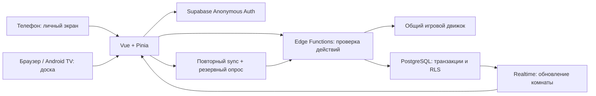

# Карта приложения

Актуально по исходникам на 28 октября 2026. Быстрый вход в контекст; предложения — в [IMPROVEMENTS.md](IMPROVEMENTS.md). Работа развёрнутого сервера и интерфейс на физических устройствах при составлении карты не проверялись.

## Продукт и основной сценарий

Race to the Bottom — биржевая игра для 2–5 игроков, по умолчанию 8 раундов. Общий экран показывает рынок и результаты, телефоны — личный портфель и скрытые карты.

1. Общий экран открывает или восстанавливает лобби; Android TV делает это автоматически через `?screen=tv`.
2. Игроки входят по QR/шестисимвольному коду. Первый участник становится лидером.
3. Лидер запускает игру. Игрок составляет до четырёх сделок, выбирает карту и завершает ход.
4. Пока не готовы все, сделки и карты не раскрываются. После последнего хода сервер применяет сделки и влияние карт.
5. Лидер запускает следующий раунд; после последнего раскрытия — показ итогов.

Cloudflare Pages раздаёт веб-сборку. Android — WebView того же сайта, отдельного игрового сервера в APK нет. По DEPLOYMENT.md публикация сайта сейчас ручная, Direct Upload.

## Где что искать

| Задача | Файлы |
|---|---|
| Выбор экрана и стартовое восстановление | `src/app/App.vue`, `src/composables/useDisplayMode.ts` |
| Сессия, черновик, сеть, роли, восстановление | `src/stores/gameStore.ts` |
| Вход и сбор игроков | `LobbyScreen.vue`, `RoomLobby.vue`, `RoomQr.vue` в `src/components/` |
| Телефон и ход | `ClientScreen.vue`, `PlayerPanel.vue`, `TradeControls.vue`, `InfluencePicker.vue` |
| Доска, раскрытие и результаты | `HostScreen.vue`, `MarketBoard.vue`, `CompanyCard.vue`, `GameOver.vue` |
| Управление, совместимость с хабами по ключу | `ManagementScreen.vue`, `HubScreen.vue`, `HubKey.vue` |
| Оформление | `src/styles.css`, `src/game/cardPresentation.ts` |
| Правила, карты, расчёты, проверка хода | `supabase/functions/_shared/game.ts` |
| Создание/восстановление доски и хабы | `supabase/functions/create-room/index.ts` |
| Присоединение игрока/наблюдателя | `supabase/functions/join-room/index.ts` |
| Sync, отправка хода, обмен, управление | `supabase/functions/game-action/index.ts` |
| Аутентификация и чтение снимка | `supabase/functions/_shared/api.ts` |
| База, права и атомарные операции | `supabase/migrations/` — читать в порядке времени |
| Android-оболочка | `android-tv/app/src/main/java/com/racetothebottom/tv/MainActivity.java` |
| Тесты | `src/tests/` — движок, store, восстановление отдельных состояний и утилиты |

## Модель данных и состояния

- `game_hubs`: постоянная привязка доски/хаба к активной комнате. Есть текущий режим `display` и совместимый режим по ключу.
- `game_sessions`: код, лидер (`host_user_id`), публичное состояние, версия, статус `active/closed`.
- `game_seats`: связь Supabase-пользователя с игроком комнаты. Имя не является удостоверением личности.
- `game_viewers`: доступ наблюдателей к комнате.
- `game_player_private`: рука, колода, сброс, выбранная карта, отложенный ход. Клиент получает только свою разрешённую часть.
- Фазы партии: `lobby → playing → reveal → playing … → finished`.
- Локальные стадии игрока: `trading → influence → ready`. Переход к влиянию локальный; после отправки сервер отмечает готовность.
- Роли интерфейса `player/main/board/manage` не заменяют серверную проверку прав.

## Как сохраняется ход

Покупка/продажа и выбор карты меняют локальный черновик. `previewTurn` показывает личный предварительный портфель; публичная доска сохраняет предыдущий результат. Обмен карты — отдельный серверный запрос.

«Закончить ход» отправляет `submit-turn` с UUID хода, номером раунда, сделками и картой. Движок проверяет ход, защищает от повторной обработки того же ID и сохраняет его приватно. Когда готовы все, рассчитывается общее раскрытие.

`commit_v3_game` под блокировкой строки проверяет версию комнаты и атомарно сохраняет публичные/приватные данные. Edge Function повторяет операцию при конфликте, до 8 попыток. Realtime сообщает об изменениях публичной комнаты; затем клиент запрашивает полный разрешённый снимок. Резервный sync — каждые 10 секунд; отдельный опрос хаба — 3/5/15 секунд в зависимости от режима.

## Что запоминает устройство

- Supabase сохраняет анонимную авторизацию; место игрока определяется её пользователем.
- Имя: cookie на год + запасное значение в localStorage (`src/lib/playerName.ts`).
- localStorage: ID последней сессии, данные хаба, черновики по комнате/игроку/раунду, последние цены и дельты.
- sessionStorage: выбранный экран. Полной серверной истории раундов сейчас нет; `lastReveal` содержит последнее раскрытие.
- `restore()` пробует восстановить комнату, но при исключении вызывает `leave()` и удаляет сохранённый ID.
- При наличии кода комнаты в URL `App.vue` пропускает обычное восстановление; показывает вход по ссылке.
- «Выйти» очищает привязку комнаты/хаба на клиенте, но не удаляет место игрока на сервере.

## Важные границы текущей реализации

- В режиме первого игрока UI предлагает новое лобби с новым кодом: сохраняется лидер, остальные входят заново; доска переключается автоматически.
- Серверный `reset` сохраняет комнату и игроков, но текущий `resetGame` не переносит `lobbyMode`. В UI этого режима кнопка сброса скрыта.
- Отдельного ID партии внутри комнаты нет: перед повторной игрой нужно решить конфликт старых черновиков с теми же номерами раундов.
- В текущем режиме доски нет явного действия передачи лидерства. Старый хаб по ключу умеет менять управляющего, в том числе переносить его место на новое устройство.
- Код входа в комнату и ключ управления хабом — разные сущности.
- Изменения общих правил затрагивают одновременно сервер и клиентский предпросмотр; их версии нужно выпускать согласованно.

## Проверка и дополнительные документы

`npm test`, `npm run typecheck`, сборка `npm run build`. При анализе прошли 45 тестов в 11 файлах и typecheck; сетевые сценарии с реальной БД не проверялись.

- [GAME_RULES.md](GAME_RULES.md) — правила.
- [DEPLOYMENT.md](DEPLOYMENT.md) — текущая процедура публикации и эксплуатации.
- [SUPABASE_SETUP.md](SUPABASE_SETUP.md) — схема и настройка backend.
- [android-tv/README.md](android-tv/README.md) — устройство и сборка оболочки.
- [todo.md](todo.md) — исходные пожелания.
